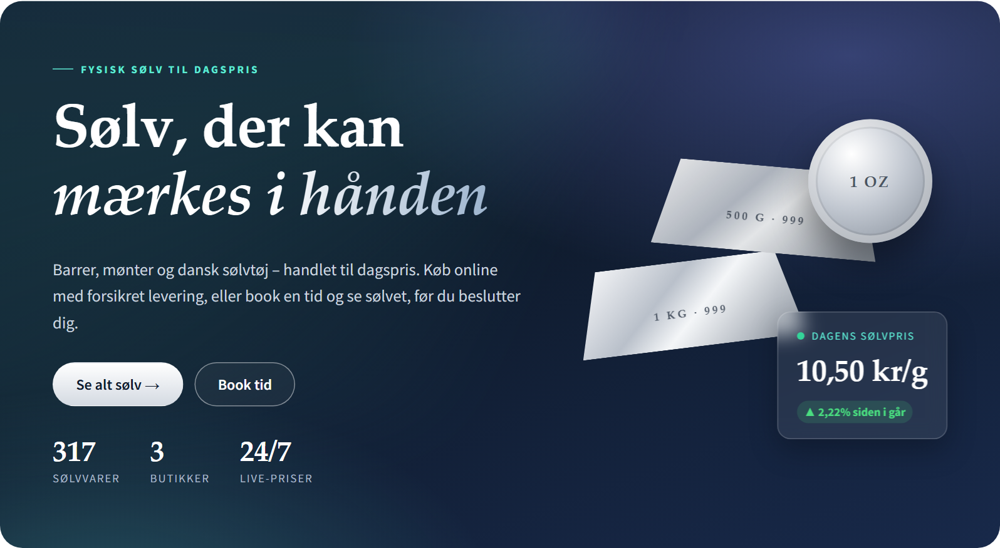
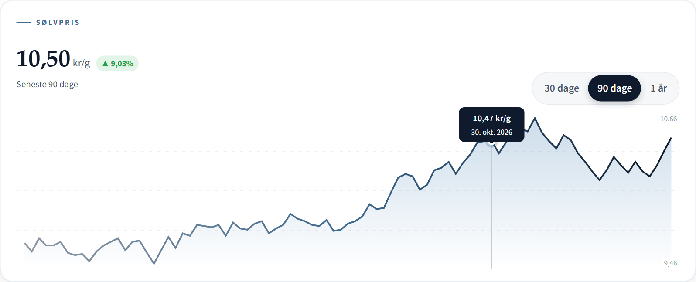
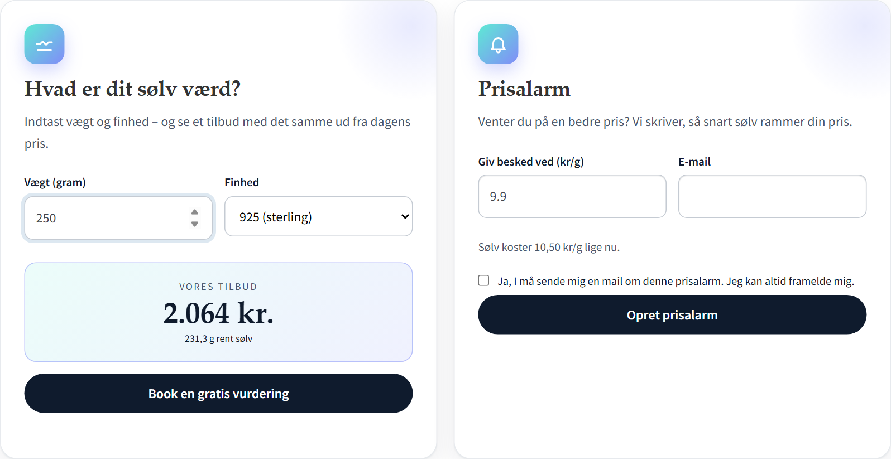
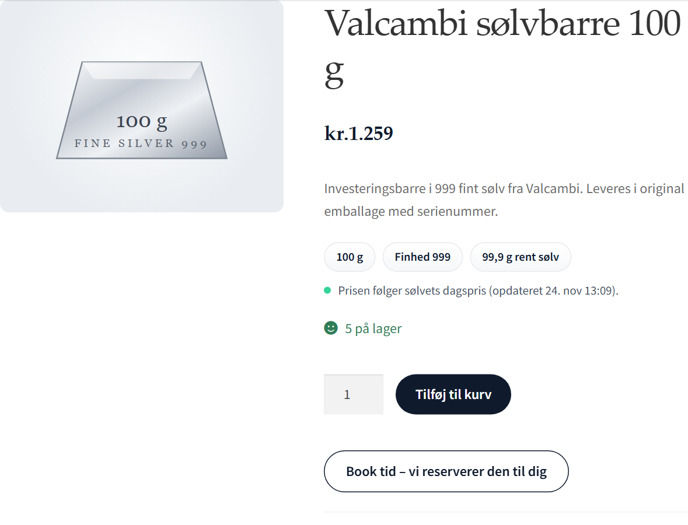
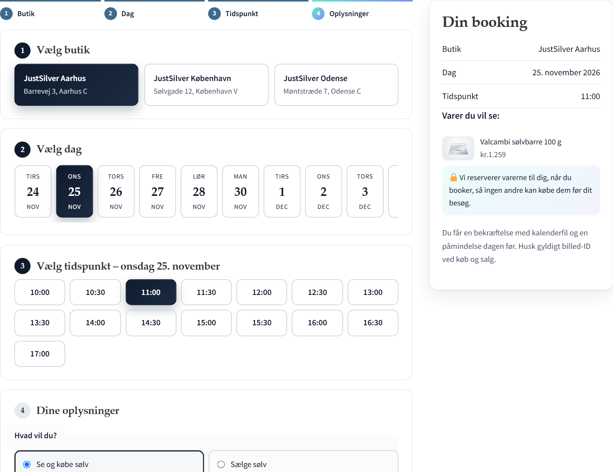
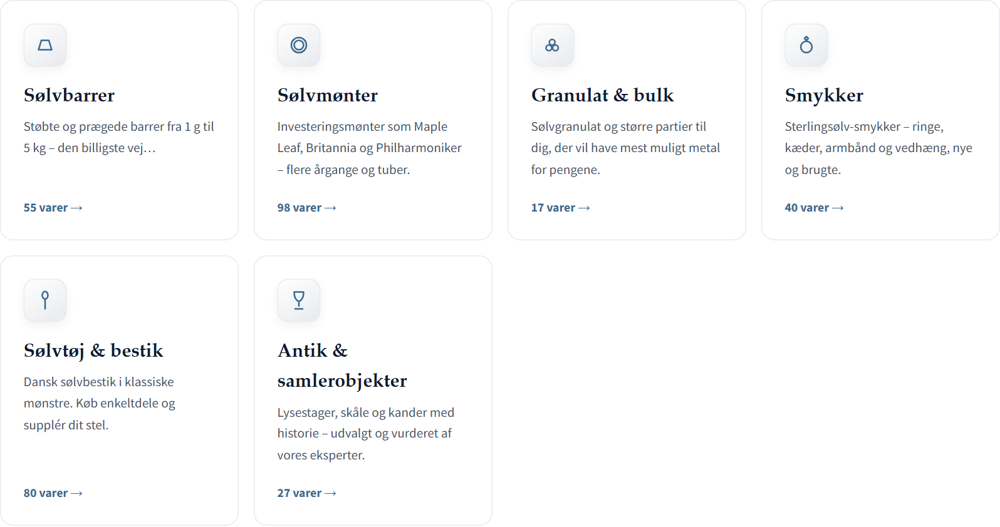
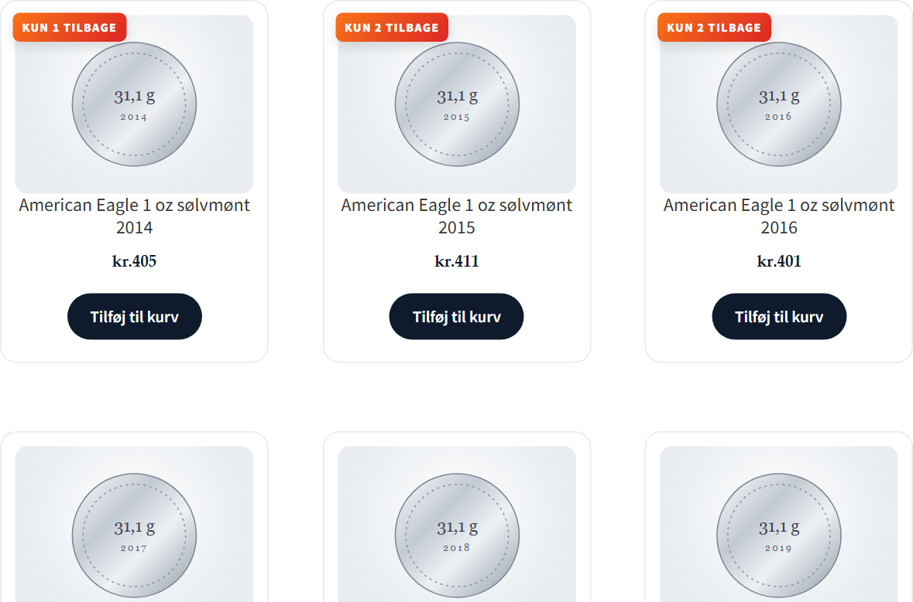

# JustSilver

[](https://github.com/Thomas-dahl-01/justsilver/actions/workflows/ci.yml)


Et WordPress/WooCommerce-plugin, der gør en almindelig webshop til en **sølvbutik**:
priser efter dagens sølvkurs, interaktiv prisgraf, prisalarmer, sælg-dit-sølv-beregner og
**tidsbestilling med reservation af varen**, så kunden kan se den i hånden, før de køber.

> JustSilver er en opdigtet butik. Alle navne, adresser, telefonnumre og e-mails i projektet er fiktive.



## Funktioner

| | |
|---|---|
| **Priser efter sølvkursen** | Pris = vægt × finhed × kurs × (1 + tillæg). Ny kurs → alle varer genberegnes i baggrunden, 100 ad gangen. |
| **Automatisk kurs** | Hentes fra metalpriceapi.com hver time. Spring på over 20 % afvises som formodet fejl. |
| **Interaktiv prisgraf** | 30 dage / 90 dage / 1 år, hover viser dagens pris. Virker også uden JavaScript. |
| **Prisalarm** | Kunden får en mail, når sølv rammer deres pris. Samtykke og framelding indbygget. |
| **Sælg dit sølv** | Vægt + finhed → tilbud med det samme, med knap til at booke en gratis vurdering. |
| **Tidsbestilling** | Butik → dag → tid. Beskyttet mod dobbeltbooking med database-lås. |
| **Reservation** | Varer, kunden booker tid til at se, tages af lageret, så ingen køber dem online imens. Frigives automatisk ved aflysning eller hvis besøget ikke gennemføres. |
| **Kalenderfil og påmindelse** | Bekræftelsen har en .ics-fil med. Påmindelse dagen før. Kunden kan aflyse fra mailen. |
| **Gutenberg-blokke** | Alle funktioner kan sættes ind med blokeditoren – med live forhåndsvisning. |
| **Oversættelig** | Engelsk kildetekst + komplet dansk oversættelse (320 tekster). |
| **Masseimport** | WooCommerce' CSV-import med sølvkolonner, til tusindvis af varer. |
| **Liv i designet** | Svævende barrer, nordlys-gradient, glimt, scroll-animationer og tællere – respekterer "reducer bevægelse". |

<table>
  <tr>
    <td></td>
    <td></td>
  </tr>
  <tr>
    <td></td>
    <td></td>
  </tr>
  <tr>
    <td></td>
    <td></td>
  </tr>
</table>

## Teknologi

- **WordPress** + **WooCommerce** (PHP 8.1+) – kører på et almindeligt webhotel
- Sølvvarer er normale WooCommerce-varer, så shoppens kurv, checkout, betaling, fragt, mails og kundekonti genbruges
- Baggrundsjob via **Action Scheduler**, kurs, påmindelser og frigivelse af reservationer via **WP-Cron**
- Kompatibel med WooCommerce' nye ordretabeller (HPOS) og checkout-blokke
- Ingen byggetrin: ren PHP, CSS og JavaScript

## Kvalitet

- **30 unit tests** (PHPUnit) af prisberegning, opkøb, ledige tider, kalenderfil, graf og CSV-import
- **Integrationstest** mod en rigtig WordPress: reservation, frigivelse, påmindelse, prisalarm og alle blokke
- **GitHub Actions** kører lint og tests på PHP 8.1–8.4, tjekker JavaScript og at oversættelsen er komplet

```sh
cd wp-plugin && composer install && vendor/bin/phpunit
```

## Kom i gang

| | |
|---|---|
| Installation og brug | [wp-plugin/README.md](wp-plugin/README.md) |
| Selve pluginet | [wp-plugin/justsilver/](wp-plugin/justsilver/) |
| Lokal test-WordPress (Docker) | [wp-dev/](wp-dev/) |

Lokal demo (kræver Docker):

```sh
cd wp-dev
docker compose up -d
MSYS_NO_PATHCONV=1 sh setup.sh   # WordPress, WooCommerce, pluginet, 317 demovarer og et års prishistorik
```

Åbn http://localhost:8080 – siderne **Sølv** og **Book tid** ligger i menuen.
